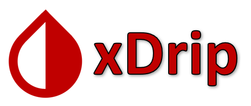
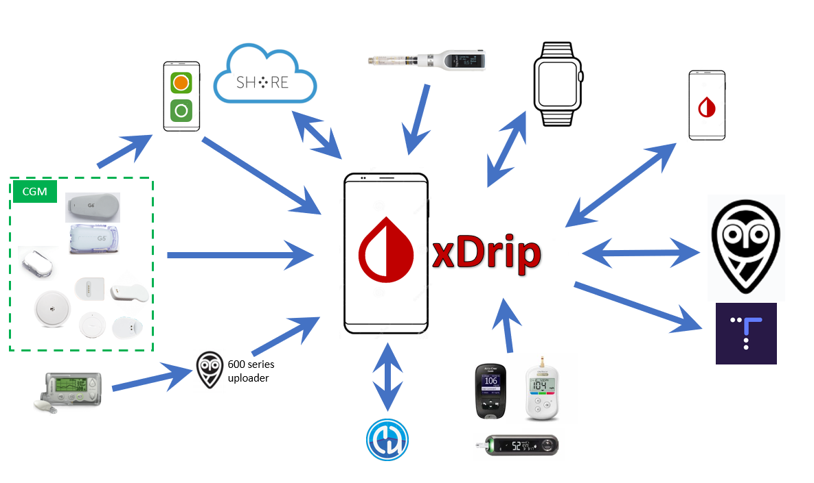

 

## Qu'est-ce que xDrip ?

xDrip est une application Android non officielle et indépendante qui sert de centrale de données et de traitement entre de nombreux appareils différents.

Elle prend en charge les connexions sans fil avec les G6, One, One+, G7, Stelo, CareSens Air, Libre par NFC et Bluetooth, Aidex, Guardian, Simplera, les pompes Medtronic, le CGM Eversense, Libre 2 et 3, ainsi qu'avec de nombreuses applications de fabricants de CGM ou de pompes (Pasta, iCan, CamAPS, Equil G, Vitatok, Glucotech, SiSensing, et d'autres) grâce au lecteur de notifications de l'application compagnon. Elle prend aussi en charge les lecteurs de glycémie Bluetooth comme le Contour Next One, l'AccuChek Guide, le Verio Flex et le Diamond Mini, ainsi que des appareils comme le stylo à insuline Pendiq 2.0.

Les données de fréquence cardiaque et de podomètre sont récupérées depuis les montres Android Wear, Garmin, Fitbit et Pebble, et depuis les cadrans qui affichent les valeurs et courbes de glycémie.

L'application offre des graphiques élaborés, de nombreuses options de personnalisation et de saisie de données, ainsi qu'un modèle de simulation prédictive.

Une synchronisation instantanée dans les deux sens est possible en associant des téléphones abonnés. Les données peuvent aussi être envoyées vers un service web Nightscout ou téléchargées depuis celui-ci, ou envoyées directement vers Nocturne, Tidepool, MongoDB ou InfluxDB.

Vous pouvez personnaliser les alarmes, la lecture vocale des valeurs, les préférences d'affichage, etc. Les utilisateurs du monde entier peuvent aussi améliorer les traductions directement depuis l'application.

Vos données vous appartiennent et peuvent être exportées de nombreuses façons. xDrip communique aussi avec d'autres applications, par exemple pour envoyer et recevoir des données en temps réel avec [AndroidAPS](https://androidaps.readthedocs.io/fr/latest/index.html).

 

## [Prêt à commencer ? C'est par ici !](./install/usethedoc/)

 

## Historique

[DexDrip](https://github.com/StephenBlackWasAlreadyTaken/DexDrip) a été créé par Emma Black en 2014, puis est devenu [xDrip](http://stephenblackwasalreadytaken.github.io/xDrip/), une application qui récupérait les données CGM d'un récepteur G4 ou d'un transmetteur et les envoyait vers [Nightscout](https://nightscout.github.io/). Elle était accompagnée de l'application de suivi [Nightwatch](http://stephenblackwasalreadytaken.github.io/NightWatch/) (obsolète).

Ce projet a ensuite été modifié par @jamorham pour devenir [xDrip](https://jamorham.github.io/#xdrip-plus).

> *Personal research version of xDrip*

 

## **Avertissement**

- **Vous utilisez xDrip à vos propres risques : n'utilisez pas les informations ou le code pour prendre des décisions médicales.**
- Le [code de github.com](https://github.com/NightscoutFoundation/xDrip) est utilisé sans garantie ni support officiel d'aucune sorte. Consultez la [LICENCE](https://github.com/NightscoutFoundation/xDrip/blob/master/LICENSE) du dépôt pour plus de détails.
- Tous les noms de produits et de sociétés, marques commerciales, marques de service et marques déposées sont la propriété de leurs détenteurs respectifs.

**Remarque :** ce projet n'est associé à aucune des sociétés suivantes et n'est approuvé par aucune d'entre elles : Abbott Laboratories, Aidex, Ascenia, i-Sens, Companion Medical, Dexcom, Medtronic, Lifescan, Medtrum, Pendiq, Roche, Senseonics, Sibionics, GlucoRx.
