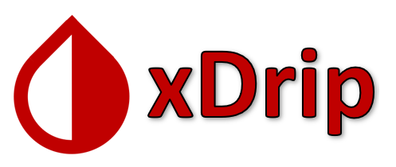
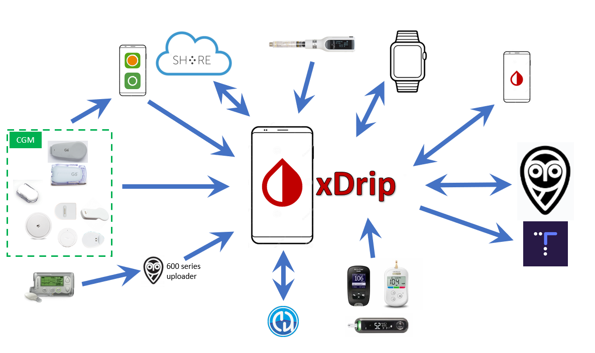

 

## Cos'è xDrip?

xDrip è un'app Android non ufficiale e indipendente che fa da centro di raccolta ed elaborazione dei dati tra molti dispositivi diversi.

Supporta connessioni wireless con G6, One, One+, G7, Stelo, CareSens Air, Libre via NFC e Bluetooth, Aidex, Guardian, Simplera, microinfusori Medtronic, CGM Eversense, Libre 2 e 3, oltre a molte app di produttori di CGM o microinfusori (Pasta, iCan, CamAPS, Equil G, Vitatok, Glucotech, SiSensing e altre) tramite il lettore di notifiche dell'app compagno. Supporta anche glucometri Bluetooth come Contour Next One, AccuChek Guide, Verio Flex e Diamond Mini, e dispositivi come la penna insulinica Pendiq 2.0.

I dati di frequenza cardiaca e contapassi vengono elaborati da smartwatch Android Wear, Garmin, Fitbit e Pebble, e dai quadranti che mostrano valori e grafici della glicemia.

L'app offre grafici avanzati, molte opzioni di personalizzazione e inserimento dati, e un modello di simulazione predittiva.

Puoi sincronizzare istantaneamente i dati in entrambe le direzioni collegando telefoni follower; i dati possono anche essere caricati su e scaricati da un servizio web Nightscout, o caricati direttamente su Nocturne, Tidepool, MongoDB o InfluxDB.

Puoi personalizzare allarmi, letture vocali, preferenze di visualizzazione e altro. Gli utenti di tutto il mondo possono anche aggiornare le traduzioni direttamente dall'app.

I tuoi dati sono tuoi e puoi esportarli in molti modi diversi. xDrip comunica anche con altre app, ad esempio inviando e ricevendo dati in tempo reale con [AndroidAPS](https://androidaps.readthedocs.io/it/latest/index.html).

 

## [Pronto a iniziare? Continua qui!](./install/usethedoc/)

 

## Storia

[DexDrip](https://github.com/StephenBlackWasAlreadyTaken/DexDrip) è stato creato da Emma Black nel 2014 ed è poi diventato [xDrip](http://stephenblackwasalreadytaken.github.io/xDrip/), un'app che raccoglieva i dati CGM da un ricevitore G4 o da un bridge e li inviava a [Nightscout](https://nightscout.github.io/). Era accompagnata dall'app follower [Nightwatch](http://stephenblackwasalreadytaken.github.io/NightWatch/) (obsoleta).

Il progetto è stato poi modificato da @jamorham ed è diventato [xDrip](https://jamorham.github.io/#xdrip-plus).

> *Personal research version of xDrip*

 

## **Avvertenze**

- **Usi xDrip a tuo rischio: non usare le informazioni o il codice per prendere decisioni mediche.**
- Il [codice su github.com](https://github.com/NightscoutFoundation/xDrip) è fornito senza garanzia né supporto formale di alcun tipo. Consulta la [LICENZA](https://github.com/NightscoutFoundation/xDrip/blob/master/LICENSE) del repository per i dettagli.
- Tutti i nomi di prodotti e aziende, marchi commerciali, marchi di servizio e marchi registrati appartengono ai rispettivi proprietari.

**Nota:** questo progetto non è associato né approvato da: Abbott Laboratories, Aidex, Ascenia, i-Sens, Companion Medical, Dexcom, Medtronic, Lifescan, Medtrum, Pendiq, Roche, Senseonics, Sibionics, GlucoRx.
