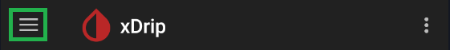

::: xdrip 
&ensp;Settings  
&emsp;Hardware Data Source  
&ensp;&emsp;xDrip Sync Follower
:::

::: warning Old xDrip Sync
In July 2024, Google shut down the deprecated [Firebase API](https://firebase.google.com/docs/cloud-messaging/migrate-v1) xDrip used for xDrip Sync.  
Update xDrip to a version from [July 23rd 2024](https://github.com/NightscoutFoundation/xDrip/releases/tag/2024.07.23) to use the legacy Sync method.  
Updating xDrip to at least the latest release is recommended.
:::

Select this data source if you've set up a device with xDrip as master and decided this other device will be the follower.  
A master device is usually the one getting BG from the sensor.  
A follower replicates readings from the master device in real time (network latency applies).

There is virtually no limit to the number of xDrip follower devices.

See [here](../use/syncsetup) how to set up xDrip Sync follower. 

 

[*Last modified 7/12/2024*](https://github.com/NightscoutFoundation/xDrip/releases/tag/2024.11.26)

